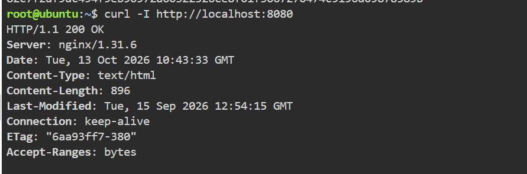
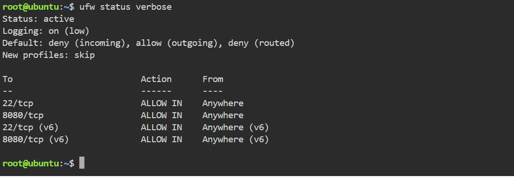
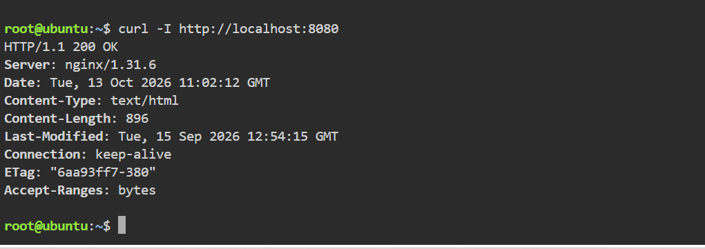

# Laboratory Activity 08: Cloud Security Engineer

**Student:** Kylle Zyrence F. Mariano  
**Course:** CCM101 – Cloud Computing  
**Laboratory Environment:** Ubuntu Linux (KillerCoda)  
**Tools:** Docker, Nginx, UFW, cURL, and GitHub

## Mission Introduction

Cloud infrastructure security is an essential responsibility in managing modern IT environments. This laboratory introduces fundamental techniques for protecting a Linux-based cloud server through network access restrictions and firewall management.

The activity focuses on deploying a containerized web application, identifying potential security risks, and implementing firewall policies to control incoming and outgoing network traffic.

## Learning Objectives

- Explain the importance of security in cloud infrastructure.
- Understand the Principle of Least Privilege.
- Recognize common attack surfaces in networked systems.
- Apply a Default Deny security policy.
- Configure and verify firewall rules using UFW.
- Test the accessibility of a Docker-hosted Nginx application.

## Laboratory Activities

### Checkpoint 1: Security Fundamentals

Research and explain three fundamental security concepts:

1. Principle of Least Privilege
2. Attack Surface
3. Default Deny Policy

The complete discussion will be documented in `security-audit-report.md`.

### Checkpoint 2: Application Deployment

Deploy an Nginx container using Docker and expose the application through port 8080.

```bash
docker run -d --name secure-web-app -p 8080:80 nginx
```

Verify application availability:

```bash
curl -I http://localhost:8080
```

### Checkpoint 3: Firewall Implementation

Configure UFW to deny unauthorized incoming traffic while permitting essential services.

```bash
ufw allow 22/tcp
ufw default deny incoming
ufw default allow outgoing
ufw allow 8080/tcp
```

Verify the firewall configuration before enabling it.

### Checkpoint 4: Security Testing

After safely enabling UFW, inspect its active rules and test whether the Nginx application remains accessible.

Record actual command outputs in the firewall configuration report.

**Note:** Docker-published ports may not be fully controlled by UFW. Local connectivity alone does not verify external network restrictions.

## Required Documentation

| File | Purpose |
|---|---|
| `README.md` | Laboratory overview and instructions |
| `security-audit-report.md` | Security principles and observations |
| `firewall-configuration.md` | Firewall configuration and test results |
| `reflection.md` | Personal learning experience |
| `screenshots/` | Evidence from actual terminal activities |

## Screenshot Evidence

The following screenshots will be added after performing the practical activities.

### Nginx Application



### UFW Firewall Status



### Application Connectivity



## Conclusion

This laboratory aims to strengthen practical knowledge of Linux server security by combining container deployment, firewall configuration, and network testing. Completing the activities will provide a foundation for understanding how security controls protect cloud-based applications.
