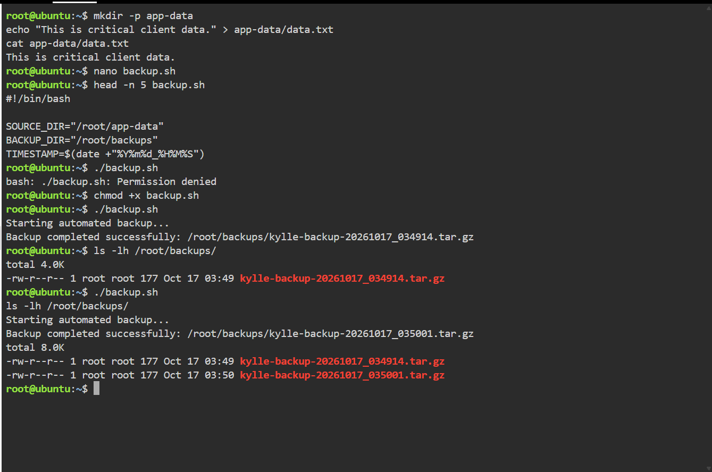
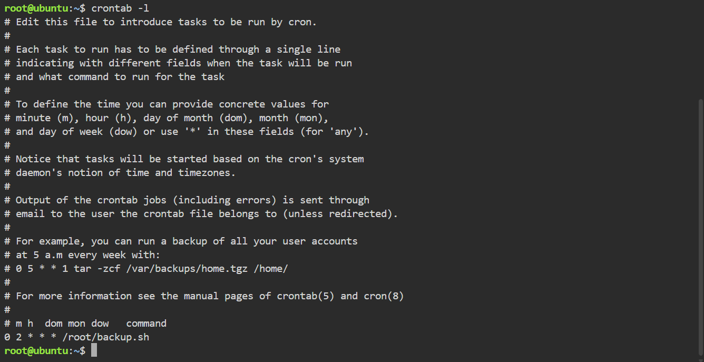

# Laboratory Activity 09: Cloud Automation Engineer

**Student:** Kylle Zyrence F. Mariano  
**Course:** CCM101 – Cloud Computing  
**Laboratory:** Mission 9 – The Cloud Automation Engineer  
**Platform:** KillerCoda Ubuntu Linux and GitHub

## Mission Overview

Cloud automation plays an important role in maintaining efficient and reliable IT operations. This laboratory introduces the use of Bash scripting and scheduled tasks to perform routine server maintenance without requiring constant manual intervention.

As a continuation of Laboratory 08, which focused on securing cloud environments, Laboratory 09 explores how automated processes can improve operational efficiency. The primary goal is to develop a script that creates compressed backups of application data and configure a Cron job to execute the script every night at 2:00 AM.

## Learning Objectives

- Understand the basic structure and purpose of Bash scripts.
- Explore how variables simplify Linux automation tasks.
- Create a backup script using standard Linux commands.
- Apply executable permissions through chmod.
- Use tar to generate compressed backup files.
- Configure scheduled tasks using Linux Cron.
- Verify automation settings and document the results.

## Laboratory Tasks

### Checkpoint 1: Researching Automation Concepts

Study the purpose of Bash scripts, the use of variables, and the role of Cron jobs in cloud operations.

Research documentation: [Automation Research](automation-research.md)

### Checkpoint 2: Developing a Backup Script

Create a Bash script that collects application data and stores it in a compressed archive with a timestamp.

### Checkpoint 3: Managing Script Permissions

Use Linux file permissions to control script execution and verify that the backup process works correctly.

### Checkpoint 4: Scheduling Automated Backups

Configure a Cron job that runs the backup script automatically every day at 2:00 AM.

### Checkpoint 5: Technical Documentation

Explain the backup script, describe the commands used, and document the Cron schedule.

Technical guide: [Backup Script Guide](backup-script-guide.md)

### Checkpoint 6: Personal Reflection

Reflect on the benefits, risks, and practical applications of automation in cloud computing.

Reflection document: [Personal Reflection](reflection.md)

## Screenshot Evidence

The following screenshots show the successful execution of the backup script and the configured daily Cron schedule.

### Backup Script Execution

### Automated Cron Schedule

## Expected Skills

By completing this laboratory, I expect to gain practical experience in writing basic Bash scripts, managing file permissions, and scheduling automated maintenance tasks in Linux.

## Conclusion

Laboratory Activity 09 highlights how automation can simplify repetitive server management responsibilities. Through Bash scripting and Cron scheduling, cloud administrators can improve consistency, reduce manual effort, and support more organized system maintenance.
